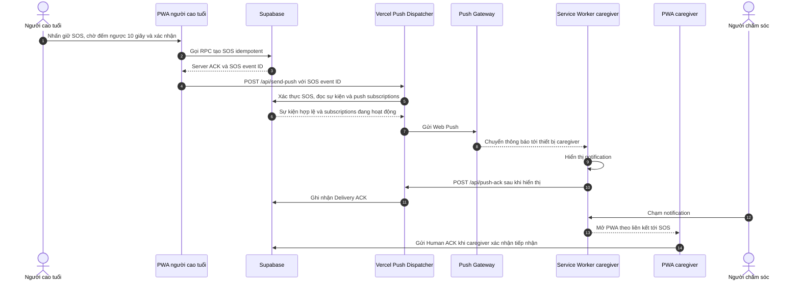
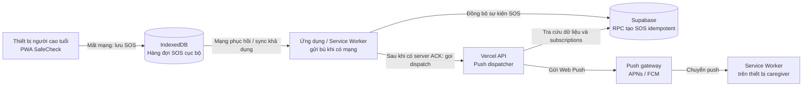
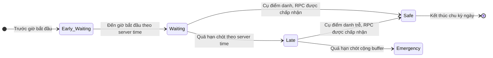

# SafeCheck

**SafeCheck** là ứng dụng web dạng Progressive Web App (PWA) hỗ trợ người cao tuổi điểm danh an toàn hằng ngày và giúp gia đình phối hợp khi có tình huống khẩn cấp.

> SafeCheck là công cụ hỗ trợ liên lạc, không phải dịch vụ cấp cứu, thiết bị y tế hay hệ thống giám sát được bảo đảm hoạt động liên tục. Khi có nguy hiểm, hãy gọi số cấp cứu tại địa phương; tại Việt Nam có thể gọi **115**. Không dựa vào ứng dụng như kênh cứu hộ duy nhất.

## Mục lục

- [Tính năng](#tính-năng)
- [Công nghệ](#công-nghệ)
- [Luồng hoạt động](#luồng-hoạt-động)
- [Bắt đầu phát triển](#bắt-đầu-phát-triển)
- [Cấu hình Supabase và môi trường](#cấu-hình-supabase-và-môi-trường)
- [Chạy, build và kiểm thử](#chạy-build-và-kiểm-thử)
- [Triển khai](#triển-khai)
- [Cấu trúc repository](#cấu-trúc-repository)
- [Giới hạn hiện tại](#giới-hạn-hiện-tại)
- [Tài liệu liên quan](#tài-liệu-liên-quan)

## Tính năng

### Dành cho người cao tuổi

- Màn hình điểm danh với thao tác đơn giản, nút bấm lớn và phản hồi bằng giọng nói/rung khi thiết bị hỗ trợ.
- Báo động SOS bằng thao tác nhấn giữ và đếm ngược có thể hủy.
- Hiển thị trạng thái sự cố, thông tin người thân đã xác nhận tiếp nhận, nút gọi **115** và danh bạ cứu hộ.
- Lưu sự kiện SOS vào hàng đợi cục bộ khi mất mạng và thử đồng bộ lại khi kết nối được khôi phục.
- Phiên đăng nhập được duy trì qua lần tải lại trang; giao diện người cao tuổi không hiển thị nút đăng xuất thông thường.

### Dành cho người chăm sóc

- Tạo tài khoản, đăng nhập và ghép nối với người cao tuổi bằng mã gia đình.
- Theo dõi trạng thái điểm danh và SOS theo thời gian thực.
- Gửi Ping để nhắc người thân kiểm tra thiết bị.
- Tùy chỉnh giờ bắt đầu, hạn chót điểm danh và khoảng đệm trước khi chuyển sang tình trạng khẩn cấp.
- Xác nhận đã tiếp nhận xử lý SOS; xem danh sách người đã xác nhận và nhật ký hoạt động gia đình.
- Quản lý danh bạ cứu hộ và bật Web Push trên các trình duyệt/thiết bị được hỗ trợ.

### Web Push và độ tin cậy

- Web Push gửi thông báo qua hạ tầng push của trình duyệt/thiết bị; Service Worker xử lý thông báo và hỗ trợ mở ứng dụng theo liên kết SOS.
- Sổ cái giao phát lưu trạng thái gửi và biên nhận thiết bị. **Biên nhận của Service Worker không đồng nghĩa người chăm sóc đã đọc hoặc xác nhận SOS.**
- Có cơ chế hàng đợi SOS ngoại tuyến, chống gửi trùng và các luồng xử lý đồng thời.
- Backend có endpoint xử lý giao phát push, biên nhận và quét/escalate sự cố.

## Công nghệ

- **Frontend:** React 19, TypeScript, Vite, Tailwind CSS.
- **Backend và dữ liệu:** Supabase Auth, PostgreSQL, Row Level Security (RLS), RPC và Realtime.
- **Thông báo:** Web Push, VAPID, Service Worker.
- **Xử lý phía máy chủ:** Vercel Serverless Functions.
- **Kiểm thử:** Playwright, TypeScript và ESLint.

## Luồng hoạt động

### 1. Luồng SOS trực tuyến và Web Push



**Sau khi thông báo được hiển thị:** Service Worker gửi **Delivery ACK** qua `/api/push-ack`, backend ghi biên nhận vào Supabase. Khi caregiver chạm thông báo, PWA mở sự cố; caregiver có thể gửi **Human ACK** xác nhận tiếp nhận về Supabase. Hai ACK này khác nhau: Delivery ACK là biên nhận kỹ thuật của thiết bị, Human ACK là hành động của con người.

**Realtime:** Supabase đồng bộ trạng thái điểm danh/SOS tới PWA của người cao tuổi và caregiver; đây là kênh cập nhật trong ứng dụng, tách biệt với Web Push.

### 2. Luồng SOS khi thiết bị người cao tuổi mất mạng



IndexedDB là hàng đợi cục bộ trên thiết bị người cao tuổi, không phải kênh gửi push. Sau khi mạng phục hồi, ứng dụng hoặc Service Worker đồng bộ SOS lên Supabase; khi có server ACK, luồng dispatch tiếp tục qua Vercel và push gateway như sơ đồ chính.

### 3. Luồng điểm danh hằng ngày: đúng giờ và trễ giờ



- Lịch riêng của Cụ xác định giờ bắt đầu, hạn chót và khoảng đệm; nếu chưa cấu hình, hệ thống dùng mặc định **07:00, 09:00 và 30 phút**.
- Khi `pg_cron` được bật và lịch được cài đặt, `check_overdue_routine_v2` chạy mỗi phút để tạo log trong ngày và chuyển trạng thái theo giờ máy chủ: `Early_Waiting → Waiting → Late → Emergency`.
- Trong `Waiting`, nút điểm danh được mở; ở `Late`, Cụ vẫn có thể điểm danh và chuyển sang `Safe`. RPC kiểm tra thời gian máy chủ, từ chối điểm danh quá sớm và không cho tự chuyển khỏi `Emergency`.
- Dashboard caregiver nhận trạng thái qua Supabase Realtime. **Trong mã hiện tại chưa tìm thấy bộ gửi Web Push riêng cho trạng thái `Late`**; PRD có mô tả cảnh báo push mức 1, vì vậy không nên xem phần đó là đã triển khai chỉ dựa trên trạng thái Late/Realtime.

## Bắt đầu phát triển

### Yêu cầu

- Node.js **20.19+** hoặc **22.12+** (theo yêu cầu của Vite hiện dùng trong dự án).
- npm.
- Một dự án Supabase để chạy ứng dụng với dữ liệu và xác thực.

### Cài đặt và chạy giao diện

Từ thư mục repository:

```powershell
cd safecheck-app
npm ci
Copy-Item .env.example .env
```

Mở `safecheck-app/.env`, điền ít nhất `VITE_SUPABASE_URL` và `VITE_SUPABASE_ANON_KEY` từ dự án Supabase. Sau đó chạy:

```powershell
npm run dev
```

Mở địa chỉ được Vite in ra trên terminal (mặc định `http://localhost:5173`).

> `npm run dev` chỉ chạy Vite cho giao diện. Các endpoint trong `safecheck-app/api/` là Vercel Serverless Functions; để thử API cục bộ, cần chạy bằng Vercel CLI (`vercel dev`) với project và biến môi trường đã cấu hình.

## Cấu hình Supabase và môi trường

### Biến môi trường

File mẫu: [`safecheck-app/.env.example`](safecheck-app/.env.example).

| Biến | Phạm vi | Mục đích |
|---|---|---|
| `VITE_SUPABASE_URL` | Client | URL dự án Supabase |
| `VITE_SUPABASE_ANON_KEY` | Client | Khóa public/anon dùng bởi Supabase client |
| `VITE_VAPID_PUBLIC_KEY` | Client | Public key cho đăng ký Web Push |
| `SUPABASE_SERVICE_ROLE_KEY` | Chỉ server | Quyền server-side cho các tác vụ backend; tuyệt đối giữ bí mật |
| `VAPID_PRIVATE_KEY` | Chỉ server | Ký Web Push; tuyệt đối giữ bí mật |
| `VAPID_SUBJECT` | Chỉ server | Định danh liên hệ VAPID, ví dụ `mailto:...` |
| `CRON_SECRET` | Chỉ server | Bí mật xác thực lời gọi worker/endpoint theo lịch |

Các biến có tiền tố `VITE_` được đưa vào bundle phía trình duyệt. **Không đặt service-role key, private key, hoặc cron secret dưới tiền tố `VITE_`, không commit file `.env` và không chia sẻ các giá trị bí mật.** Khóa anon/public không thay thế cho chính sách RLS; hãy cấu hình quyền truy cập trong Supabase.

### Khởi tạo cơ sở dữ liệu

Các migration được lưu theo thứ tự thời gian tại [`supabase/migrations/`](supabase/migrations/).

- **Dự án Supabase mới:** có thể mở [`supabase/schema_full.sql`](supabase/schema_full.sql) trong Supabase SQL Editor và chạy toàn bộ schema một lần.
- **Cơ sở dữ liệu đã tồn tại:** áp dụng migration mới theo thứ tự bằng Supabase CLI và quy trình quản lý database của dự án. Không chạy lại schema tổng hợp trên một database đã được khởi tạo.
- Từ repository root, `node supabase/combine_migrations.cjs` tạo lại `supabase/schema_full.sql` từ các migration hiện có.
- Repository có các script `db:push`, `db:pull`, `db:diff` trong `package.json` ở root. Cài dependency của root bằng `npm install`, sau đó các lệnh này cần Supabase CLI, một dự án đã liên kết và cấu hình CLI phù hợp.

Luôn sao lưu và xác nhận đúng project/database trước khi chạy thay đổi schema; không thử nghiệm migration trên dữ liệu production ngoài quy trình được phê duyệt.

### Web Push

Để đăng ký và gửi Web Push, cần cấu hình VAPID key public ở client và VAPID key private ở môi trường server. Người dùng cũng phải cấp quyền thông báo cho trình duyệt.

Trên iPhone/iPad, Web Push phụ thuộc phiên bản iOS/iPadOS và chế độ cài đặt PWA. Với các phiên bản yêu cầu, người dùng cần thêm SafeCheck vào Màn hình chính rồi mở ứng dụng đã cài trước khi bật thông báo. Push vẫn phụ thuộc hệ điều hành, trình duyệt, quyền thông báo, kết nối và nhà cung cấp; không đảm bảo thời gian hoặc việc giao nhận.

## Chạy, build và kiểm thử

Chạy các lệnh sau trong `safecheck-app`:

```bash
npm run build
npm run lint
npx playwright test
```

- `npm run build` chạy TypeScript build và tạo bản production trong `dist/`.
- `npm run lint` chạy ESLint.
- Playwright tự khởi động Vite theo cấu hình trong `playwright.config.ts`; cấu hình hiện tại không tự khởi động các Vercel Serverless Functions. Suite nào cần `/api/*` phải chạy với môi trường có các function đó, hoặc điều chỉnh cấu hình test phù hợp.
- Sau khi chạy có thể xem báo cáo HTML bằng `npx playwright show-report`.
- Chạy một suite cụ thể, ví dụ: `npx playwright test tests/01_auth.spec.ts`.

Các test có thể đăng ký tài khoản hoặc ghi dữ liệu vào dịch vụ Supabase được cấu hình. Hãy dùng **dự án Supabase dành riêng cho kiểm thử**, không trỏ test vào dữ liệu production. Số lượng test trong repository không phải bằng chứng rằng toàn bộ test đã được chạy thành công gần đây.

Để xem thử bản build:

```bash
npm run preview
```

## Triển khai

Dự án có thể triển khai trên Vercel. Khi cấu hình project, đặt **Root Directory** là `safecheck-app` để Vercel nhận đúng Vite app, `api/` serverless functions và cấu hình rewrites trong `safecheck-app/vercel.json`.

Thiết lập các biến môi trường client và server trong Vercel trước khi build/deploy. Không đưa secret vào mã nguồn hoặc biến `VITE_*`. Sau deploy, kiểm tra riêng:

1. Trang ứng dụng và đăng nhập Supabase.
2. Quyền truy cập RLS và các RPC cần thiết.
3. Các endpoint `/api/send-push`, `/api/push-ack`, `/api/check-escalation`.
4. Đăng ký push, giao nhận trên thiết bị thật và xử lý khi thiết bị offline.

Không xem việc deploy thành công là bằng chứng rằng Push hoặc kênh cứu hộ viễn thông hoạt động end-to-end.

## Cấu trúc repository

```text
.
├── README.md
├── package.json                 # Supabase CLI scripts ở repository root
├── supabase/
│   ├── migrations/              # Migration PostgreSQL có thứ tự
│   ├── schema_full.sql          # Schema tổng hợp
│   └── combine_migrations.cjs   # Tạo schema_full.sql từ migrations
├── Report_PRD/                  # PRD, báo cáo và tài liệu QA
└── safecheck-app/
    ├── api/                     # Vercel Serverless Functions
    ├── public/sw.js             # Service Worker
    ├── src/
    │   ├── components/          # Màn hình và UI theo vai trò
    │   ├── hooks/               # Logic nghiệp vụ theo domain
    │   ├── services/            # Supabase, lịch, offline, push, SOS
    │   └── utils/
    ├── tests/                   # Playwright E2E và kiểm tra bảo mật
    ├── package.json
    └── vite.config.ts
```

## Giới hạn hiện tại

- SafeCheck không thay thế số điện thoại cấp cứu, nhân viên y tế, thiết bị phát hiện té ngã hay hệ thống giám sát chuyên dụng.
- SOS lưu ngoại tuyến không thể đến máy chủ hoặc người thân cho đến khi mạng phục hồi; màn hình cung cấp lựa chọn gọi 115 trực tiếp.
- Mã backend hiện có luồng và sổ cái fallback, nhưng việc tích hợp gửi SMS tới nhà cung cấp thật chưa được xác nhận; gửi cuộc gọi thoại tự động cũng chưa được triển khai/xác nhận. Không coi thông báo trạng thái `provider_accepted` mô phỏng là bằng chứng SMS đã gửi thật.
- Chưa có GPS khẩn cấp hoặc ứng dụng native iOS/Android.
- Thông báo push có thể bị trì hoãn hoặc không đến do thiết bị, quyền hệ điều hành, trình duyệt, gateway hay mạng.

## Tài liệu liên quan

- [Báo cáo SafeCheck v2 và phụ lục cập nhật](Report_PRD/ReportSafeCheck_v2.md)
- [Báo cáo Deep Resilience v2](Report_PRD/Report_Deepv2.md)
- [PRD tổng quan](Report_PRD/PRD.md)
- [PRD xác thực và kết nối gia đình](Report_PRD/PRD_AUTH_FAMILY.md)
- [PRD lịch điểm danh](Report_PRD/PRD_CHECKIN_SCHEDULE.md)
- [PRD SOS](Report_PRD/PRD_SOS.md)
- [PRD Web Push](Report_PRD/PRD_NotiSOS.md)
- [PRD Deep Resilience v3](Report_PRD/PRD_Deep_v3.md)
- [Quy trình QA trên thiết bị thật](Report_PRD/QA/REAL_DEVICE_QA_PROTOCOL.md)
