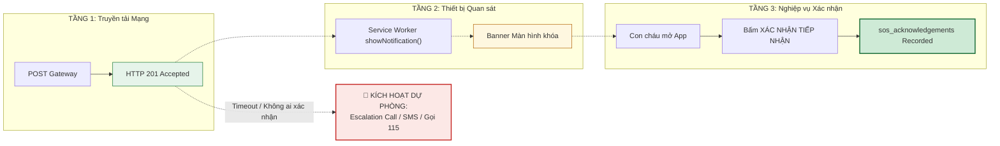
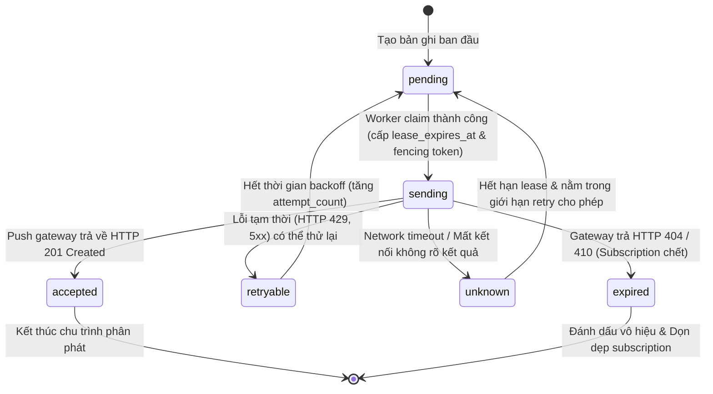
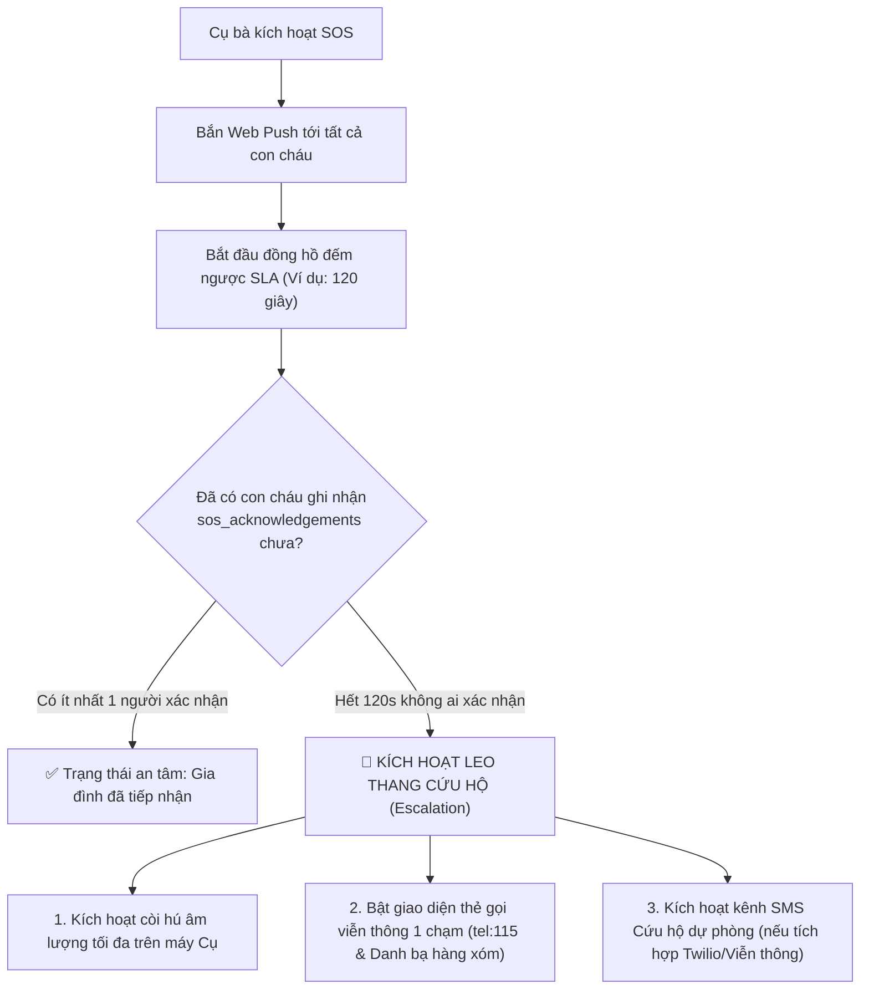

# Product Requirements Document (PRD): Chuyên Sâu Hạ Tầng - Phân Phát Web Push Cứu Hộ & Khả Năng Chịu Lỗi Thực Tế Khi Thiết Bị Ngủ Sâu (Resilient Web Push Dispatch & Failure-Domain Architecture)

> **Mã tài liệu:** `PRD_Deep_v2.md`  
> **Dự án:** SafeCheck - Hệ thống Điểm danh & Cứu hộ Người cao tuổi  
> **Phiên bản:** v2.1 (Engineering Reality & Safety-First Revision)  
> **Trạng thái:** Bản kiến trúc chuẩn hóa - Đã hiệu chỉnh toàn diện theo phản biện kỹ thuật P0  
> **Tác giả:** Đội ngũ Kỹ thuật SafeCheck  
> **Hệ quy chiếu chuẩn:**  
> 1. Web Push là **kênh truyền tải cảnh báo ngoại tuyến (Out-of-band Transport Channel)**, *tuyệt đối không phải bằng chứng xác nhận người thân đã tiếp nhận tình huống khẩn cấp*.  
> 2. Thực thể cốt lõi: `sos_events` (Chân lý sự kiện), `push_subscriptions` (Định danh thiết bị VAPID), `push_deliveries` (Sổ cái phân phát kèm Lease & Fencing Token), và `sos_acknowledgements` (Trạng thái phản hồi thực tế của người thân).  

---

## 1. Triết lý Kỹ thuật & Tuyên bố Ranh giới (Engineering Principles & Boundaries)

Để bảo vệ sinh mạng người cao tuổi, SafeCheck tuân thủ nguyên tắc **"Không tạo cảm giác an toàn giả" (No False Sense of Security)**:

```
┌──────────────────────────────────────────────────────────────────────────────────────────────────┐
│  NGUYÊN TẮC CỐT LÕI CỦA HỆ THỐNG CỨU HỘ SAFECHECK:                                               │
│                                                                                                  │
│  1. HTTP 201 từ Apple/Google CHỈ CHỨNG MINH: "Push gateway đã tiếp nhận gói tin".                │
│     -> KHÔNG CHỨNG MINH: Thiết bị đã nhận.                                                       │
│     -> KHÔNG CHỨNG MINH: Màn hình đã sáng hoặc chuông đã reo.                                    │
│     -> CÀNG KHÔNG CHỨNG MINH: Con cháu đã đọc tin và đang đi cứu người.                          │
│                                                                                                  │
│  2. Mọi cam kết phân phát phải là: "Idempotent dispatch with duplicate-risk mitigation",          │
│     thay vì ảo tưởng "Exactly-once delivery" trong môi trường mạng phân tán.                     │
│                                                                                                  │
│  3. Hệ thống phải có cơ chế Phát hiện cảnh báo chưa được tiếp nhận (Escalation / Fallback)       │
│     thay vì chỉ mù quáng tối ưu tốc độ gửi push.                                                 │
└──────────────────────────────────────────────────────────────────────────────────────────────────┘
```

---

## 2. Bối cảnh & Phân tích Lỗ hổng Kỹ thuật (Problem Statement & Failure Domains)

### 2.1. Vấn đề 1: Bản chất Best-Effort của Apple APNs và Google FCM
- **Thực tế giao thức:** Cả Apple APNs và Google FCM đều là các dịch vụ **Best-Effort (Nỗ lực tối đa nhưng không bảo đảm 100%)**. Khi thiết bị ở trạng thái Low Power Mode, pin yếu, hoặc mạng di động chập chờn, gateway có quyền xếp hàng, sắp xếp lại thứ tự (re-order) hoặc trì hoãn gói tin.
- **Rủi ro khi ngộ nhận:** Nếu frontend hoặc server tin rằng "đã bắn push thành công = cụ bà đã an toàn", hệ thống sẽ bỏ qua bước cảnh báo dự phòng.
- **Yêu cầu kỹ thuật:** Đo lường độ trễ thực tế theo phân vị P50 / P95 / P99 trên thiết bị thật; thiết lập SLA phản hồi có giám sát.

### 2.2. Vấn đề 2: Cạm bẫy của TTL = 0 đối với Tín hiệu Cứu hộ
- **Phân tích chuẩn RFC 8030 (Web Push Protocol):**
  - Khi một Web Push có `TTL: 0`, nếu tại đúng thời điểm đó thiết bị của người thân đang mất mạng (đi thang máy, đi qua hầm xe, rớt sóng 4G tạm thời 15 giây), **Push gateway sẽ hủy bỏ ngay lập tức gói tin mà không lưu đệm**.
  - Kết quả: Khi người thân vừa bước ra khỏi thang máy, điện thoại bắt lại sóng thì **cảnh báo SOS đã vĩnh viễn biến mất**.
- **Giải pháp chuẩn hóa:** Phân tách chính sách TTL theo từng loại thông điệp:
  - **SOS Initial Alert (Báo động khẩn cấp ban đầu):** Đặt `TTL = 300` (5 phút) hoặc theo SLA cứu hộ đã thống nhất, cho phép gateway lưu đệm tạm thời để kịp phân phát ngay khi thiết bị tái kết nối trong khung giờ vàng.
  - **SOS Resolved / Status Update (Hủy/Giải quyết báo động):** Đặt `TTL = 60` (hoặc ngắn hơn) kết hợp với Web Push `Topic` để ghi đè, không lưu cữu thông tin cũ.

### 2.3. Vấn đề 3: Khoảng trống Two Generals' Problem trong Idempotency
- **Kịch bản đứt gãy mạng biên:**
  1. Worker Serverless gửi request đẩy Web Push sang Apple/Google.
  2. Apple/Google nhận thành công, gửi mã `HTTP 201 Created` về.
  3. Đúng lúc này, mạng kết nối giữa Vercel và internet bị rớt, hoặc Vercel container bị kill do chạm ngưỡng CPU/RAM trước khi kịp thực hiện lệnh `UPDATE push_deliveries SET status = 'accepted'`.
  4. Lần retry tiếp theo không thể biết lượt gửi trước đã thành công hay chưa.
- **Kết luận kiến trúc:** Bảng `push_deliveries` giúp **giảm thiểu tối đa (mitigate)** nguy cơ gửi lặp và ngăn chặn các worker chạy song song dẫm chân nhau, nhưng không thể loại trừ 100% tình huống duplicate ở biên mạng. Cần cơ chế xử lý thông minh cả ở backend lẫn phía Service Worker.

### 2.4. Vấn đề 4: Nhầm lẫn giữa Native APNs Headers và W3C Web Push Protocol
- SafeCheck sử dụng **W3C Web Push API kết hợp RFC 8292 (VAPID)** gửi tới endpoint dạng `https://web.push.apple.com/...`.
- Apple Safari Web Push tuân thủ **chuẩn RFC 8030 Web Push**, sử dụng các header tiêu chuẩn của giao thức Web Push (`TTL`, `Urgency`, `Topic`), **không phải native APNs binary/HTTP2 protocol**.
- Việc truyền các header native APNs không được tài liệu hóa chính thức cho Web Push endpoint (`apns-priority`, `apns-push-type`, `apns-expiration`, `apns-collapse-id`) có thể bị gateway bỏ qua, bị thư viện `web-push` loại bỏ, hoặc thậm chí gây lỗi cú pháp nếu gateway siết chặt schema.
- **Yêu cầu kỹ thuật:** Sử dụng chuẩn RFC 8030 làm **nền tảng cốt lõi (Baseline)**:
  - `Urgency: high`
  - `TTL: <giá trị giây>`
  - `Topic: <định danh gom cụm Web Push>`

---

## 3. Kiến trúc State Machine & Luồng Vận hành (System Architecture)

### 3.1. Phân định Ba Cấp độ Trạng thái Cứu hộ (Three Separation Layers)



---

### 3.2. State Machine Chi tiết của `push_deliveries` (Sổ cái Phân phát)

Để giải quyết vấn đề worker chậm trễ (slow worker) tranh chấp với worker mới, mỗi lượt gửi được kiểm soát bởi một **Lease có thời hạn** kết hợp với **Fencing Token (`attempt_count`)**:



#### Giải nghĩa các Trạng thái trong Sổ cái:
1. **`pending`**: Bản ghi đã sẵn sàng để được một worker nhận việc (claim).
2. **`sending`**: Một worker cụ thể đang giữ Lease độc quyền xử lý. Các worker khác không được can thiệp cho đến khi Lease hết hạn.
3. **`accepted`**: Push gateway (Apple/Google) đã phản hồi thành công (HTTP 201).
4. **`retryable`**: Lỗi có bằng chứng rõ ràng là gói tin chưa được xử lý (429 Rate Limit, 502/503 Bad Gateway) $\rightarrow$ Thử lại có kiểm soát.
5. **`unknown`**: Request gửi đi nhưng bị timeout hoặc đứt kết nối giữa chừng $\rightarrow$ Không thể biết gateway đã nhận hay chưa $\rightarrow$ Phải áp dụng chính sách xử lý rủi ro trùng lặp có kiểm soát (Backoff + Max attempts).
6. **`expired`**: Subscription đã bị hủy bỏ bởi người dùng hoặc trình duyệt (HTTP 404/410).

---

## 4. Thiết kế Cơ sở Dữ liệu & RPC Functions (Database Schema & Security)

### 4.1. Bảng Sổ cái Phân phát `push_deliveries`

> [!IMPORTANT]
> **Bảo vệ tính toàn vẹn của Nhật ký Kiểm toán:**  
> Không dùng `ON DELETE CASCADE` cho các khóa ngoại liên kết với `push_subscriptions` hoặc `profiles`. Nếu một thiết bị hủy đăng ký hoặc một tài khoản thay đổi, lịch sử phân phát cứu hộ trong quá khứ **tuyệt đối không được phép biến mất**.

```sql
-- Migration: 20260922000000_resilient_push_deliveries.sql

CREATE TABLE IF NOT EXISTS public.push_deliveries (
    id UUID PRIMARY KEY DEFAULT gen_random_uuid(),
    sos_event_id UUID NOT NULL REFERENCES public.sos_events(id) ON DELETE RESTRICT,
    caregiver_id UUID NOT NULL REFERENCES public.profiles(id) ON DELETE RESTRICT,
    subscription_id UUID REFERENCES public.push_subscriptions(id) ON DELETE SET NULL,
    endpoint_hash TEXT NOT NULL, -- SHA-256 hash của endpoint để truy vấn nhanh
    
    -- Định danh nghiệp vụ duy nhất chống nhân bản bản ghi
    idempotency_key TEXT NOT NULL UNIQUE, -- Định dạng: sos_event_id || '_' || subscription_id
    
    -- Trạng thái phân phát theo State Machine chuẩn
    status VARCHAR(20) NOT NULL DEFAULT 'pending' 
        CHECK (status IN ('pending', 'sending', 'accepted', 'retryable', 'unknown', 'expired')),
    
    -- Cơ chế Lease & Fencing Token chống xung đột worker
    lease_owner TEXT, -- Định danh của worker instance (vd: process_id hoặc invocation_id)
    lease_expires_at TIMESTAMPTZ, -- Thời điểm hết hạn khóa tạm thời
    attempt_count INT NOT NULL DEFAULT 0 CHECK (attempt_count >= 0),
    max_attempts INT NOT NULL DEFAULT 3,
    
    -- Dữ liệu chẩn đoán & phản hồi từ Push Gateway
    http_status INT,
    response_body TEXT,
    error_message TEXT,
    
    -- Các mốc thời gian quan sát được
    created_at TIMESTAMPTZ NOT NULL DEFAULT timezone('utc'::text, now()),
    updated_at TIMESTAMPTZ NOT NULL DEFAULT timezone('utc'::text, now()),
    accepted_at TIMESTAMPTZ
);

CREATE INDEX IF NOT EXISTS idx_push_deliveries_sos ON public.push_deliveries(sos_event_id);
CREATE INDEX IF NOT EXISTS idx_push_deliveries_caregiver ON public.push_deliveries(caregiver_id);
CREATE INDEX IF NOT EXISTS idx_push_deliveries_status ON public.push_deliveries(status);
CREATE INDEX IF NOT EXISTS idx_push_deliveries_lease ON public.push_deliveries(lease_expires_at) 
    WHERE status = 'sending';

-- Kích hoạt RLS
ALTER TABLE public.push_deliveries ENABLE ROW LEVEL SECURITY;

-- Caregiver chỉ được SELECT lịch sử của chính mình
DROP POLICY IF EXISTS "Caregivers can view own push deliveries" ON public.push_deliveries;
CREATE POLICY "Caregivers can view own push deliveries"
ON public.push_deliveries FOR SELECT
USING (auth.uid() = caregiver_id);
```

---

### 4.2. Bảng Theo dõi Phản hồi Cứu hộ `sos_acknowledgements` (Business Truth)

```sql
CREATE TABLE IF NOT EXISTS public.sos_acknowledgements (
    id UUID PRIMARY KEY DEFAULT gen_random_uuid(),
    sos_event_id UUID NOT NULL REFERENCES public.sos_events(id) ON DELETE RESTRICT,
    caregiver_id UUID NOT NULL REFERENCES public.profiles(id) ON DELETE RESTRICT,
    acknowledged_at TIMESTAMPTZ NOT NULL DEFAULT timezone('utc'::text, now()),
    channel VARCHAR(30) NOT NULL DEFAULT 'app_click' CHECK (channel IN ('app_click', 'voice_call', 'manual_confirmation')),
    client_metadata JSONB DEFAULT '{}'::jsonb,
    
    UNIQUE (sos_event_id, caregiver_id)
);

CREATE INDEX IF NOT EXISTS idx_sos_ack_event ON public.sos_acknowledgements(sos_event_id);

ALTER TABLE public.sos_acknowledgements ENABLE ROW LEVEL SECURITY;

DROP POLICY IF EXISTS "Family members can view acknowledgements" ON public.sos_acknowledgements;
CREATE POLICY "Family members can view acknowledgements"
ON public.sos_acknowledgements FOR SELECT
USING (
    EXISTS (
        SELECT 1 FROM public.sos_events se
        JOIN public.family_links fl ON fl.elderly_id = se.elderly_id
        WHERE se.id = sos_acknowledgements.sos_event_id
          AND (fl.caregiver_id = auth.uid() OR se.elderly_id = auth.uid())
          AND fl.status = 'accepted'
    )
);

DROP POLICY IF EXISTS "Caregivers can insert own acknowledgement" ON public.sos_acknowledgements;
CREATE POLICY "Caregivers can insert own acknowledgement"
ON public.sos_acknowledgements FOR INSERT
WITH CHECK (auth.uid() = caregiver_id);
```

---

### 4.3. Hàm RPC Khóa Lease Nguyên tử (`claim_push_delivery_lease`)

> [!CAUTION]
> **Nguyên tắc Bảo mật RPC (Defense-in-Depth):**  
> - Hàm `SECURITY DEFINER` **phải khóa chặt `SET search_path = ''`**.  
> - Thu hồi toàn bộ quyền thực thi khỏi `PUBLIC` và `anon`. Chỉ cho phép `service_role` (backend tin cậy) hoặc người sở hữu sự kiện gọi hàm.  
> - Bắt buộc kiểm tra quan hệ gia đình hợp lệ trước khi phân phát.

```sql
CREATE OR REPLACE FUNCTION public.claim_push_delivery_lease(
    p_sos_event_id UUID,
    p_caregiver_id UUID,
    p_subscription_id UUID,
    p_endpoint_hash TEXT,
    p_idempotency_key TEXT,
    p_worker_id TEXT,
    p_lease_duration_seconds INT DEFAULT 15
)
RETURNS JSONB
LANGUAGE plpgsql
SECURITY DEFINER
SET search_path = ''
AS $$
DECLARE
    v_delivery RECORD;
    v_now TIMESTAMPTZ := timezone('utc'::text, now());
    v_lease_expiry TIMESTAMPTZ := v_now + (p_lease_duration_seconds || ' seconds')::INTERVAL;
    v_new_attempt INT;
BEGIN
    -- 1. Bảo mật: Xác thực sự kiện SOS đang active và người nhận thuộc gia đình hợp lệ
    IF NOT EXISTS (
        SELECT 1 FROM public.sos_events se
        JOIN public.family_links fl ON fl.elderly_id = se.elderly_id
        WHERE se.id = p_sos_event_id
          AND fl.caregiver_id = p_caregiver_id
          AND fl.status = 'accepted'
          AND se.status = 'active'
    ) THEN
        RETURN jsonb_build_object(
            'can_send', false,
            'reason', 'INVALID_RELATION_OR_INACTIVE_SOS'
        );
    END IF;

    -- 2. Thử chèn bản ghi mới nếu chưa tồn tại
    INSERT INTO public.push_deliveries (
        sos_event_id,
        caregiver_id,
        subscription_id,
        endpoint_hash,
        idempotency_key,
        status,
        lease_owner,
        lease_expires_at,
        attempt_count,
        created_at,
        updated_at
    )
    VALUES (
        p_sos_event_id,
        p_caregiver_id,
        p_subscription_id,
        p_endpoint_hash,
        p_idempotency_key,
        'sending',
        p_worker_id,
        v_lease_expiry,
        1,
        v_now,
        v_now
    )
    ON CONFLICT (idempotency_key) DO NOTHING
    RETURNING * INTO v_delivery;

    -- 3. Nếu chèn thành công -> Cấp Lease đầu tiên
    IF v_delivery.id IS NOT NULL THEN
        RETURN jsonb_build_object(
            'can_send', true,
            'delivery_id', v_delivery.id,
            'attempt_count', 1,
            'reason', 'NEW_LEASE_ACQUIRED'
        );
    END IF;

    -- 4. Nếu bản ghi đã tồn tại, khóa hàng (FOR UPDATE) để đánh giá trạng thái
    SELECT * INTO v_delivery
    FROM public.push_deliveries
    WHERE idempotency_key = p_idempotency_key
    FOR UPDATE;

    -- Không gửi lại nếu đã được gateway tiếp nhận hoặc đã expired
    IF v_delivery.status IN ('accepted', 'expired') THEN
        RETURN jsonb_build_object(
            'can_send', false,
            'delivery_id', v_delivery.id,
            'reason', 'TERMINAL_STATE_' || v_delivery.status
        );
    END IF;

    -- Kiểm tra vượt ngưỡng retry tối đa
    IF v_delivery.attempt_count >= v_delivery.max_attempts THEN
        RETURN jsonb_build_object(
            'can_send', false,
            'delivery_id', v_delivery.id,
            'reason', 'MAX_ATTEMPTS_EXCEEDED'
        );
    END IF;

    -- Nếu đang có worker khác nắm giữ Lease hợp lệ -> Tránh đụng độ
    IF v_delivery.status = 'sending' AND v_delivery.lease_expires_at > v_now THEN
        RETURN jsonb_build_object(
            'can_send', false,
            'delivery_id', v_delivery.id,
            'reason', 'LEASE_HELD_BY_ANOTHER_WORKER'
        );
    END IF;

    -- Cho phép Worker hiện tại nhận lại Lease (khi trạng thái là retryable, unknown, hoặc lease cũ đã hết hạn)
    v_new_attempt := v_delivery.attempt_count + 1;
    UPDATE public.push_deliveries
    SET status = 'sending',
        lease_owner = p_worker_id,
        lease_expires_at = v_lease_expiry,
        attempt_count = v_new_attempt,
        updated_at = v_now
    WHERE id = v_delivery.id;

    RETURN jsonb_build_object(
        'can_send', true,
        'delivery_id', v_delivery.id,
        'attempt_count', v_new_attempt,
        'reason', 'LEASE_RENEWED'
    );
END;
$$;

-- Phân quyền chặt chẽ
REVOKE ALL ON FUNCTION public.claim_push_delivery_lease(UUID, UUID, UUID, TEXT, TEXT, TEXT, INT) FROM PUBLIC, anon;
GRANT EXECUTE ON FUNCTION public.claim_push_delivery_lease(UUID, UUID, UUID, TEXT, TEXT, TEXT, INT) TO service_role, authenticated;
```

---

### 4.4. Hàm RPC Hoàn tất và Xác thực Fencing Token (`complete_push_delivery_fenced`)

```sql
CREATE OR REPLACE FUNCTION public.complete_push_delivery_fenced(
    p_delivery_id UUID,
    p_worker_id TEXT,
    p_attempt_count INT,
    p_status VARCHAR(20),
    p_http_status INT DEFAULT NULL,
    p_response_body TEXT DEFAULT NULL,
    p_error_message TEXT DEFAULT NULL
)
RETURNS JSONB
LANGUAGE plpgsql
SECURITY DEFINER
SET search_path = ''
AS $$
DECLARE
    v_delivery RECORD;
    v_now TIMESTAMPTZ := timezone('utc'::text, now());
BEGIN
    -- Kiểm tra tính hợp lệ của trạng thái đích
    IF p_status NOT IN ('accepted', 'retryable', 'unknown', 'expired') THEN
        RETURN jsonb_build_object('success', false, 'error', 'INVALID_TARGET_STATUS');
    END IF;

    -- Khóa hàng để kiểm tra Fencing Token
    SELECT * INTO v_delivery
    FROM public.push_deliveries
    WHERE id = p_delivery_id
    FOR UPDATE;

    IF NOT FOUND THEN
        RETURN jsonb_build_object('success', false, 'error', 'DELIVERY_NOT_FOUND');
    END IF;

    -- Fencing Token Check: Worker cũ (attempt thấp hơn hoặc không phải lease_owner) không được ghi đè
    IF v_delivery.lease_owner != p_worker_id OR v_delivery.attempt_count != p_attempt_count THEN
        RETURN jsonb_build_object(
            'success', false,
            'error', 'FENCING_REJECTED',
            'detail', 'Stale worker invocation attempted to overwrite state'
        );
    END IF;

    -- Cập nhật trạng thái
    UPDATE public.push_deliveries
    SET status = p_status,
        http_status = p_http_status,
        response_body = p_response_body,
        error_message = p_error_message,
        lease_owner = NULL,
        lease_expires_at = NULL,
        updated_at = v_now,
        accepted_at = CASE WHEN p_status = 'accepted' THEN v_now ELSE accepted_at END
    WHERE id = p_delivery_id;

    RETURN jsonb_build_object('success', true, 'status', p_status);
END;
$$;

REVOKE ALL ON FUNCTION public.complete_push_delivery_fenced(UUID, TEXT, INT, VARCHAR, INT, TEXT, TEXT) FROM PUBLIC, anon;
GRANT EXECUTE ON FUNCTION public.complete_push_delivery_fenced(UUID, TEXT, INT, VARCHAR, INT, TEXT, TEXT) TO service_role, authenticated;
```

---

## 5. Cấu hình Backend Dispatcher (`/api/send-push.js` v2)

### 5.1. Chuẩn hóa Tùy chọn Web Push theo RFC 8030

```javascript
// Cấu hình chuẩn Web Push Protocol RFC 8030
const webPushOptions = {
  // 1. SOS Ban đầu: TTL = 300 giây (5 phút) để bao quát tình huống đi thang máy / rớt sóng tạm thời
  // Tránh việc để TTL = 0 làm mất tín hiệu cứu hộ ngay khi vừa mất sóng 5 giây
  TTL: isInitialSOSAlert ? 300 : 60,

  // 2. Độ khẩn cấp tối đa của giao thức Web Push
  urgency: 'high',

  // 3. Topic chuẩn Web Push để gom cụm và thay thế thông báo cũ
  topic: `sos-${sos_event_id.slice(0, 16)}`,
};
```

> [!NOTE]
> **Về các Headers mở rộng của Apple:**  
> Nếu môi trường triển khai xác nhận endpoint thuộc domain `*.push.apple.com`, dispatcher có thể bổ sung các header tương thích được Apple công bố chính thức cho Web Push. Tuy nhiên, toàn bộ logic cốt lõi và kiểm thử phải hoạt động chuẩn mực dựa trên **RFC 8030 Baseline** (`TTL`, `urgency: 'high'`, `topic`).

### 5.2. Phân loại Phản hồi Lỗi (Error Classification Matrix)

| Mã HTTP từ Push Gateway | Phân loại Trạng thái | Hành động của Hệ thống |
| :--- | :--- | :--- |
| **201 Created** | `accepted` | Ghi nhận Gateway đã tiếp nhận; giải phóng Lease thành công. |
| **404 Not Found / 410 Gone** | `expired` | Subscription đã hết hạn hoặc bị thu hồi. Đánh dấu `expired` và đưa endpoint vào danh sách dọn dẹp `push_subscriptions`. |
| **429 Too Many Requests** | `retryable` | Gateway bị nghẽn. Đọc header `Retry-After` (nếu có), giải phóng lease với trạng thái `retryable` kèm backoff. |
| **500 / 502 / 503 / 504** | `retryable` | Lỗi phía máy chủ Apple/Google. Giải phóng lease cho phép lần sau retry (nếu còn trong `max_attempts`). |
| **Client Network Timeout** | `unknown` | Timeout phía Vercel (không rõ Gateway đã nhận hay chưa). Ghi nhận `unknown`, tăng `attempt_count` và áp dụng chính sách duplicate-risk mitigation. |

---

## 6. Service Worker (`sw.js`): Giảm thiểu Nguy cơ Vi phạm WebKit & Chống Spam UI

### 6.1. Nguyên tắc Xử lý Sự kiện `push`
1. **Zero-Network Fetch:** Không gọi bất kỳ API nào ra bên ngoài trong handler `push`. Toàn bộ dữ liệu hiển thị (`elderly_name`, `sos_event_id`, `timestamp`) nằm gọn trong encrypted payload.
2. **Bắt buộc hiển thị Notification:** Đảm bảo `event.waitUntil(self.registration.showNotification(...))` luôn hoàn tất thành công để không bị Safari gắn cờ vi phạm chính sách hiển thị.
3. **Chống Spam Chuông Hú khi Retry (`renotify: false`):**
   - Với các gói tin gửi bù (retry) của **cùng một sự kiện SOS**, đặt cờ `renotify: false` kết hợp với `tag: safecheck-sos-${sos_event_id}`.
   - Trình duyệt sẽ cập nhật nội dung trên màn hình nhưng **không rung chuông inh ỏi lần thứ 2/lần thứ 3**, tránh gây hoảng loạn tâm lý cho người thân.

### 6.2. Mã nguồn Chuẩn mực trong `sw.js`

```javascript
self.addEventListener('push', (event) => {
  let data = {};
  if (event.data) {
    try {
      data = event.data.json();
    } catch (e) {
      data = { body: event.data.text() };
    }
  }

  const sosEventId = data.sos_event_id || '';
  const elderlyName = data.elderly_name || 'Người thân';
  const isUpdate = Boolean(data.is_update);

  const title = isUpdate 
    ? `ℹ️ SafeCheck - Cập nhật SOS: ${elderlyName}`
    : `🚨 SafeCheck - CẢNH BÁO SOS: ${elderlyName}`;

  const options = {
    body: data.body || `${elderlyName} vừa kích hoạt cảnh báo khẩn cấp! Nhấn để mở ứng dụng.`,
    icon: '/apple-touch-icon.png',
    badge: '/icon-192.png',
    tag: `safecheck-sos-${sosEventId || 'broadcast'}`,
    
    // Chỉ rung chuông dồn dập ở tin nhắn đầu tiên; nếu là retry cùng tag thì không renotify tránh spam
    renotify: isUpdate ? false : !data.is_retry,
    
    // Yêu cầu giữ thông báo trên màn hình nếu trình duyệt hỗ trợ
    requireInteraction: true,
    
    data: {
      sos_event_id: sosEventId,
      url: `/?sos=${sosEventId}`,
      timestamp: data.timestamp || Date.now(),
    },
  };

  // Giữ Service Worker sống cho đến khi thông báo được hiển thị
  event.waitUntil(
    self.registration.showNotification(title, options).catch((err) => {
      // Fallback khẩn cấp tối giản để bảo toàn quyền push của Safari WebKit
      return self.registration.showNotification('🚨 SafeCheck SOS!', {
        body: 'Có tín hiệu cứu hộ khẩn cấp từ người thân!',
        icon: '/apple-touch-icon.png',
      });
    })
  );
});

// Điều hướng khi người dùng chạm vào thông báo
self.addEventListener('notificationclick', (event) => {
  event.notification.close();
  const targetUrl = event.notification.data?.url || '/';

  event.waitUntil(
    self.clients.matchAll({ type: 'window', includeUncontrolled: true }).then((clientList) => {
      for (const client of clientList) {
        if ('focus' in client) {
          client.focus();
          if ('navigate' in client && targetUrl) {
            return client.navigate(targetUrl);
          }
          return client;
        }
      }
      if (self.clients.openWindow) {
        return self.clients.openWindow(targetUrl);
      }
    })
  );
});
```

---

## 7. Cơ chế Dự phòng & Leo thang (Escalation & Fallback Strategy)

Hệ thống SafeCheck không bao giờ dừng lại ở việc gửi Web Push thành công:



---

## 8. Ma trận Kiểm thử Dựa trên Dữ liệu Thực tế (Data-Driven Verification Matrix)

Thay vì đưa ra các cam kết không thể kiểm soát (như "< 3 giây" hoặc "100% không rớt"), đội ngũ kỹ thuật nghiệm thu hệ thống dựa trên các **chỉ số đo lường thực nghiệm**:

| Mã TC | Kịch bản Kiểm thử | Môi trường | Tiêu chí Đo lường & Nghiệm thu |
| :--- | :--- | :--- | :--- |
| **TC-01** | **Đo độ trễ phân phát khi máy ngủ sâu (Deep Sleep / Doze)** | iPhone Standalone PWA & Android để qua đêm (> 4 giờ không mở máy) | Đo thời gian từ lúc server gửi đến khi màn hình nhận thông báo. Ghi nhận phân vị **P50 < 5s, P95 < 25s**. Đánh giá hành vi khi cắm sạc vs chạy pin. |
| **TC-02** | **Xử lý thiết bị offline trong thời gian ngắn** | Thiết bị con cháu tắt mạng/bật Airplane Mode trong 30 giây rồi bật lại | Chứng minh `TTL: 300` giúp thông báo **được phân phát ngay** khi có mạng lại (so sánh với `TTL: 0` bị rớt hoàn toàn). |
| **TC-03** | **Worker Timeout & Tranh chấp Lease đồng thời** | Hai worker cùng gọi `claim_push_delivery_lease` cho cùng một `idempotency_key` | Chứng minh chỉ đúng 1 worker nhận được `can_send = true`. Worker còn lại nhận `LEASE_HELD_BY_ANOTHER_WORKER`. |
| **TC-04** | **Fencing Token ngăn chặn Worker cũ ghi đè** | Worker 1 bị nghẽn 20s (quá hạn lease). Worker 2 claim và tăng `attempt_count`. Worker 1 tỉnh lại gọi complete | RPC trả về lỗi `FENCING_REJECTED`, ngăn chặn worker cũ làm sai lệch trạng thái mới. |
| **TC-05** | **Zero-Network Service Worker Resilience** | Chặn toàn bộ kết nối domain ngoài bên trong Service Worker | Service Worker vẫn hiển thị đầy đủ thông báo với tên cụ bà và không bị Safari WebKit thu hồi quyền. |
| **TC-06** | **Chống Spam Chuông Hú (`renotify: false`)** | Giả lập retry gửi 3 lần cho cùng 1 thiết bị | Thiết bị hiển thị cập nhật thông báo trên thanh thông báo nhưng **chỉ reo chuông/rung 1 lần duy nhất**. |
| **TC-07** | **Subscription hết hạn (HTTP 410 Gone)** | Thu hồi quyền thông báo trên trình duyệt client rồi kích hoạt gửi push | Gateway trả về 410 $\rightarrow$ Bản ghi chuyển sang `expired`, endpoint tự động bị xóa khỏi `push_subscriptions`. |
| **TC-08** | **Kích hoạt Escalation khi không có Acknowledgement** | Không có người thân nào mở app bấm xác nhận trong 120 giây | Giao diện máy cụ tự động chuyển sang thẻ khẩn cấp viễn thông Cellular Call Fallback. |

---

## 9. Lộ trình Triển khai 3 Giai đoạn (Phased Implementation Roadmap)

### Giai đoạn 1: Tính Đúng đắn & An toàn Dữ liệu (Correctness & Security)
- [x] Viết migration tạo bảng `push_deliveries` và `sos_acknowledgements`.
- [x] Cài đặt 2 hàm RPC an toàn `claim_push_delivery_lease` và `complete_push_delivery_fenced` với cơ chế Lease & Fencing Token.
- [x] Thiết lập chính sách RLS và `REVOKE EXECUTE FROM PUBLIC, anon`.
- [x] Chuẩn hóa tùy chọn Web Push theo **RFC 8030 Baseline** (`urgency: 'high'`, `TTL: 300` cho SOS).

### Giai đoạn 2: Khả năng Chịu lỗi Thiết bị (Device Reliability)
- [x] Tối ưu `sw.js`: Zero-Network handler, xử lý `renotify: false` chống spam UI khi retry, triệt tiêu Phantom SOS.
- [x] Nâng cấp `/api/send-push.js`: Phân loại lỗi mạng, 429 (`Retry-After`), 410, và ghi nhận trạng thái `accepted` / `retryable` / `unknown`.
- [x] Xây dựng bộ test suite mô phỏng 6 ca Service Worker (`tests/11_device_reliability_sw.spec.ts` - 100% Passed).
- [x] Soạn thảo quy trình thực nghiệm trên thiết bị thật ([REAL_DEVICE_QA_PROTOCOL.md](file:///c:/Users/lhp14/learn_afterUni/SafeCheck/Report_PRD/REAL_DEVICE_QA_PROTOCOL.md)).
- [ ] Tiến hành đo lường thực tế trên iPhone iOS 16.4+ Standalone PWA và Android Chromium.

### Giai đoạn 3: Phục hồi Đầu-Cuối & Cơ chế Leo thang (End-to-End Resilience & Escalation)
- [x] Xây dựng UI ghi nhận xác nhận của người thân (`sos_acknowledgements`) & danh sách phối hợp Realtime (`CaregiverScreen.tsx`).
- [x] Kích hoạt Fallback viễn thông trên máy Cụ bà nếu sau SLA 120s không có ai xác nhận (`ElderlyScreen.tsx`, `useSos.ts`, `CellularFallbackCard.tsx`).
- [x] Tổ chức diễn tập kịch bản cứu hộ khẩn cấp toàn diện (Drill Test) 10/10 kịch bản đạt 100% Passed (`tests/12_emergency_drill_escalation.spec.ts`).
