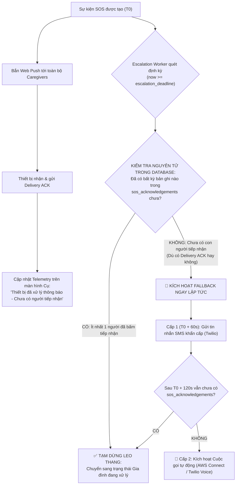
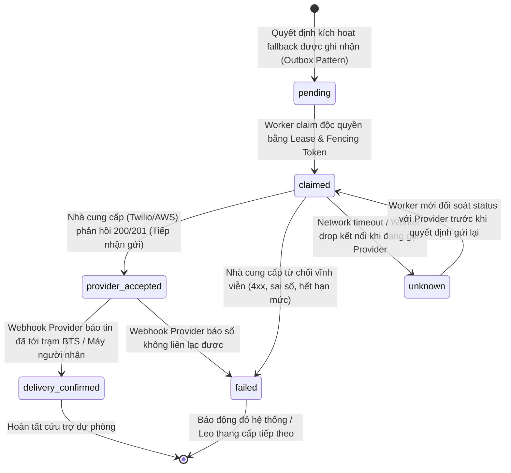

# Product Requirements Document (PRD): Bắt Tay Hai Chiều Xác Nhận Giao Phát & Kênh Cứu Hộ Dự Phòng Tự Động (Two-Way Push Delivery Handshake & Autonomous Multi-Channel Fallback)

> **Mã tài liệu:** `PRD_Deep_v3.md`  
> **Dự án:** SafeCheck - Hệ thống Điểm danh & Cứu hộ Người cao tuổi  
> **Phiên bản:** v3.2 (Production-Grade Hardening, Failure Semantics & Atomic Safety)  
> **Trạng thái:** Bản kiến trúc chuẩn hóa cấp Production - Nâng cấp từ phản biện chuyên sâu  
> **Tác giả:** Đội ngũ Kỹ thuật SafeCheck  
> **Hệ quy chiếu chuẩn:**  
> 1. **Zero-Regression Principle:** Toàn bộ kiến trúc v2 (Sổ cái `push_deliveries` kèm Lease/Fencing Token, `api/send-push.js`, `sos_acknowledgements`, drill test 10/10) **phải được bảo toàn 100%**. Tính năng v3.2 là tầng gia tăng (Additive & Non-breaking).  
> 2. **Ranh giới Phân định Trạng thái (Semantics Boundary):** Tuyệt đối không đánh tráo giữa "Service Worker xử lý hiển thị" và "Người dùng thực tế đã nhìn/nghe thấy". Phân tách rạch ròi 4 thực thể: `push_deliveries`, `sos_events`, `sos_acknowledgements`, và `sos_fallbacks`.  
> 3. **Quy Tắc Fallback Sống Còn:** `delivery_acked` của thiết bị **KHÔNG ĐƯỢC MIỄN TRỪ HOẶC TRÌ HOÃN** việc kích hoạt kênh cứu hộ dự phòng. Chỉ có hành động xác nhận tiếp nhận của con người (`sos_acknowledgements`) mới được coi là sự cố đã có người chăm sóc xử lý.  

---

## 1. Triết lý Kỹ thuật & Tuyên bố Ranh giới (Engineering Principles & Semantics)

```
┌──────────────────────────────────────────────────────────────────────────────────────────────────┐
│  BẢNG CHUẨN HÓA NGỮ NGHĨA KỸ THUẬT VÀ TUYÊN BỐ TRÊN GIAO DIỆN (v3.2):                             │
│                                                                                                  │
│  1. ACCEPTED (Tầng 1 - Gateway):                                                                 │
│     - Kỹ thuật: Apple APNs hoặc Google FCM chấp nhận gói tin (HTTP 201).                         │
│     - Tuyên bố UX: "Hệ thống đã phát cảnh báo tới cổng thông báo Apple/Google".                  │
│     - Ranh giới: Không chứng minh máy con có sóng hay có mạng.                                   │
│                                                                                                  │
│  2. DELIVERY_ACKED (Tầng 2 - Device Hop):                                                        │
│     - Kỹ thuật: showNotification() hoàn tất VÀ Service Worker gửi ngầm ACK về server.            │
│     - Tuyên bố UX: "Thiết bị của [Tên] đã xác nhận xử lý thông báo qua Service Worker             │
│                     lúc HH:mm:ss — Chưa xác nhận người chăm sóc đã tiếp nhận".                   │
│     - Ranh giới: Chỉ dùng cập nhật Telemetry quan sát; KHÔNG được miễn trừ kích hoạt Fallback.    │
│                                                                                                  │
│  3. ACKNOWLEDGED (Tầng 3 - Human Action):                                                        │
│     - Kỹ thuật: Người thân mở app và bấm nút "XÁC NHẬN TIẾP NHẬN CỨU HỘ".                        │
│     - Tuyên bố UX: "Người chăm sóc [Tên] đã xác nhận đang xử lý cứu hộ lúc HH:mm:ss".            │
│     - Ranh giới: Bằng chứng duy nhất để tạm dừng chu trình leo thang khẩn cấp.                   │
│                                                                                                  │
│  4. RESOLVED (Tầng 4 - Incident Closed):                                                         │
│     - Kỹ thuật: Cụ hoặc Người thân bấm hoàn tất / hủy báo động theo quy trình an toàn.           │
│     - Tuyên bố UX: "Sự cố cứu hộ đã được giải quyết an toàn".                                    │
└──────────────────────────────────────────────────────────────────────────────────────────────────┘
```

---

## 2. Quy Tắc Kích Hoạt Cứu Hộ Dự Phòng (Autonomous Escalation Decision Rules)

Khắc phục hoàn toàn lỗ hổng bỏ sót trường hợp người thân nhận push nhưng đang bận/lái xe/ngủ say:



> [!IMPORTANT]
> **Quy tắc Vàng Nghiệp Vụ:**  
> - `delivery_ack_count` $\ge 1$ chỉ chứng minh thiết bị đã nhận gói tin.  
> - Nếu `human_ack_count == 0` khi chạm mốc `escalation_deadline`, **Fallback BẮT BUỘC PHẢI CHẠY**. Tính mạng người cao tuổi không thể đánh cược vào việc một thiết bị đã sáng màn hình nhưng chủ nhân không mở ra xem.

---

## 3. Mô Hình Dữ Liệu & State Machine Bền Vững (Failure Semantics)

### 3.1. Phân Tách 4 Bảng Trách Nhiệm Độc Lập
1. **`push_deliveries`**: Chỉ theo dõi từng lần gửi Web Push tới từng subscription:
   `status`: `pending` $\rightarrow$ `sending` $\rightarrow$ `accepted` $\rightarrow$ `delivery_acked` / `delivery_timeout` / `retryable` / `unknown` / `expired`.
2. **`sos_events`**: Nắm giữ Chân lý Sự kiện cứu hộ (`active`, `escalated`, `resolved`, `cancelled`).
3. **`sos_acknowledgements`**: Nhật ký con người tiếp nhận (`app_click`, `voice_call`, `manual_confirmation`).
4. **`sos_fallbacks`**: Sổ cái Outbox phân phát kênh viễn thông dự phòng, tách bạch các giai đoạn phản hồi của Provider.

### 3.2. Vòng Đời Trạng Thái Kênh Dự Phòng Viễn Thông (`sos_fallbacks.status`)

Để xử lý bài toán **Side-effect ngoài không thể thu hồi khi Worker chết giữa chừng**:



---

## 4. Thiết Kế Cơ Sở Dữ Liệu & RPC Giao Dịch Nguyên Tử

### 4.1. Migration SQL v3.2 (`supabase/migrations/20261014000000_push_delivery_ack_schema.sql`)

```sql
-- Migration: 20261014000000_push_delivery_ack_schema.sql

-- 1. Bổ sung giá trị hợp lệ cho status của push_deliveries (Bảo toàn dữ liệu cũ)
ALTER TABLE public.push_deliveries
    DROP CONSTRAINT IF EXISTS push_deliveries_status_check;

ALTER TABLE public.push_deliveries
    ADD CONSTRAINT push_deliveries_status_check 
    CHECK (status IN ('pending', 'sending', 'accepted', 'delivery_acked', 'retryable', 'unknown', 'expired', 'delivery_timeout'));

ALTER TABLE public.push_deliveries
    ADD COLUMN IF NOT EXISTS delivery_acked_at TIMESTAMPTZ,
    ADD COLUMN IF NOT EXISTS client_ack_metadata JSONB DEFAULT '{}'::jsonb;

CREATE INDEX IF NOT EXISTS idx_push_deliveries_acked 
    ON public.push_deliveries(sos_event_id, delivery_acked_at) 
    WHERE delivery_acked_at IS NOT NULL;

-- 2. Bảng Sổ Cái Kênh Cứu Hộ Dự Phòng sos_fallbacks (Outbox & Provider Semantics)
CREATE TABLE IF NOT EXISTS public.sos_fallbacks (
    id UUID PRIMARY KEY DEFAULT gen_random_uuid(),
    sos_event_id UUID NOT NULL REFERENCES public.sos_events(id) ON DELETE RESTRICT,
    caregiver_id UUID REFERENCES public.profiles(id) ON DELETE RESTRICT,
    
    -- Khóa Idempotency cấp doanh nghiệp chống gửi trùng:
    -- Định dạng: sos_event_id || '_' || channel || '_' || tier || '_' || target_phone
    idempotency_key TEXT NOT NULL UNIQUE,
    
    channel VARCHAR(30) NOT NULL CHECK (channel IN ('sms_twilio', 'voice_call_aws', 'webhook_emergency')),
    tier INT NOT NULL DEFAULT 1 CHECK (tier >= 1),
    target_phone TEXT NOT NULL,
    recipient_name TEXT,
    
    trigger_reason VARCHAR(50) NOT NULL 
        CHECK (trigger_reason IN ('delivery_timeout', 'all_endpoints_dead', 'no_human_ack')),
    
    -- State Machine chuẩn Production
    status VARCHAR(25) NOT NULL DEFAULT 'pending' 
        CHECK (status IN ('pending', 'claimed', 'provider_accepted', 'delivery_confirmed', 'failed', 'unknown', 'retryable')),
    
    -- Cơ chế Lease & Fencing Token cho Worker
    lease_owner TEXT,
    lease_expires_at TIMESTAMPTZ,
    fence_token BIGINT NOT NULL DEFAULT 0,
    attempt_count INT NOT NULL DEFAULT 0 CHECK (attempt_count >= 0),
    max_attempts INT NOT NULL DEFAULT 3,
    
    -- Bằng chứng phản hồi từ nhà cung cấp viễn thông
    provider_message_id TEXT,
    provider_request_payload JSONB DEFAULT '{}'::jsonb,
    provider_response JSONB DEFAULT '{}'::jsonb,
    error_message TEXT,
    
    -- Mốc thời gian
    created_at TIMESTAMPTZ NOT NULL DEFAULT timezone('utc'::text, now()),
    updated_at TIMESTAMPTZ NOT NULL DEFAULT timezone('utc'::text, now()),
    accepted_at TIMESTAMPTZ,
    confirmed_at TIMESTAMPTZ
);

CREATE INDEX IF NOT EXISTS idx_sos_fallbacks_event ON public.sos_fallbacks(sos_event_id);
CREATE INDEX IF NOT EXISTS idx_sos_fallbacks_lease ON public.sos_fallbacks(lease_expires_at) 
    WHERE status IN ('pending', 'claimed', 'unknown');

ALTER TABLE public.sos_fallbacks ENABLE ROW LEVEL SECURITY;

CREATE POLICY "Caregivers and elderly can view fallbacks"
ON public.sos_fallbacks FOR SELECT
USING (
    EXISTS (
        SELECT 1 FROM public.sos_events se
        JOIN public.family_links fl ON fl.elderly_id = se.elderly_id
        WHERE se.id = sos_fallbacks.sos_event_id
          AND (fl.caregiver_id = auth.uid() OR se.elderly_id = auth.uid())
          AND fl.status = 'accepted'
    )
);
```

### 4.2. RPC Nguyên Tử: Quyết Định Kích Hoạt Fallback An Toàn Tuyệt Đối (`claim_sos_fallback_atomic`)

Hàm này giải quyết đồng thời các vấn đề **P0-01, P0-02, P1-01**: Kiểm tra Human ACK, kiểm tra Deadline, và Cấp quyền gửi (Claim Lease) trong **CÙNG MỘT GIAO DỊCH DATABASE**:

```sql
CREATE OR REPLACE FUNCTION public.claim_sos_fallback_atomic(
    p_sos_event_id UUID,
    p_channel TEXT,
    p_tier INT,
    p_idempotency_key TEXT,
    p_target_phone TEXT,
    p_recipient_name TEXT,
    p_trigger_reason TEXT,
    p_worker_id TEXT,
    p_lease_seconds INT DEFAULT 30
)
RETURNS JSONB
LANGUAGE plpgsql
SECURITY DEFINER
SET search_path = ''
AS $$
DECLARE
    v_event RECORD;
    v_human_ack_count INT;
    v_fallback RECORD;
    v_now TIMESTAMPTZ := timezone('utc'::text, now());
BEGIN
    -- 1. Kiểm tra sự kiện SOS (Khóa hàng FOR UPDATE để chống Race Condition)
    SELECT * INTO v_event
    FROM public.sos_events
    WHERE id = p_sos_event_id
    FOR UPDATE;

    IF v_event.id IS NULL THEN
        RETURN jsonb_build_object('can_send', false, 'reason', 'SOS_EVENT_NOT_FOUND');
    END IF;

    IF v_event.status IN ('resolved', 'cancelled') THEN
        RETURN jsonb_build_object('can_send', false, 'reason', 'SOS_EVENT_ALREADY_TERMINATED');
    END IF;

    -- 2. ĐIỀU KIỆN SỐNG CÒN: Kiểm tra đã có người chăm sóc nào bấm tiếp nhận chưa
    SELECT COUNT(*) INTO v_human_ack_count
    FROM public.sos_acknowledgements
    WHERE sos_event_id = p_sos_event_id;

    IF v_human_ack_count > 0 THEN
        RETURN jsonb_build_object('can_send', false, 'reason', 'HUMAN_ALREADY_ACKNOWLEDGED');
    END IF;

    -- 3. Kiểm tra hạn chót SLA (Trừ trường hợp khẩn cấp: all_endpoints_dead)
    IF p_trigger_reason <> 'all_endpoints_dead' AND v_event.escalation_deadline > v_now THEN
        RETURN jsonb_build_object('can_send', false, 'reason', 'SLA_DEADLINE_NOT_REACHED');
    END IF;

    -- 4. Tìm hoặc tạo bản ghi Fallback Outbox
    SELECT * INTO v_fallback
    FROM public.sos_fallbacks
    WHERE idempotency_key = p_idempotency_key
    FOR UPDATE;

    IF v_fallback.id IS NULL THEN
        INSERT INTO public.sos_fallbacks (
            sos_event_id, channel, tier, idempotency_key, target_phone, recipient_name,
            trigger_reason, status, lease_owner, lease_expires_at, fence_token, attempt_count
        ) VALUES (
            p_sos_event_id, p_channel, p_tier, p_idempotency_key, p_target_phone, p_recipient_name,
            p_trigger_reason, 'claimed', p_worker_id, v_now + (p_lease_seconds || ' seconds')::INTERVAL, 1, 1
        )
        RETURNING * INTO v_fallback;

        RETURN jsonb_build_object(
            'can_send', true,
            'fallback_id', v_fallback.id,
            'fence_token', 1,
            'target_phone', v_fallback.target_phone
        );
    END IF;

    -- Nếu đã được Provider tiếp nhận hoặc đã giao thành công -> CHẶN ĐỨNG GỬI LẶP
    IF v_fallback.status IN ('provider_accepted', 'delivery_confirmed') THEN
        RETURN jsonb_build_object('can_send', false, 'reason', 'ALREADY_SENT_TO_PROVIDER');
    END IF;

    -- Nếu đang có worker khác nắm Lease còn hạn -> CHẶN ĐỨNG TRANH CHẤP
    IF v_fallback.status = 'claimed' AND v_fallback.lease_expires_at > v_now THEN
        RETURN jsonb_build_object('can_send', false, 'reason', 'LEASE_HELD_BY_ANOTHER_WORKER');
    END IF;

    -- Quá số lần thử tối đa -> Khóa lại
    IF v_fallback.attempt_count >= v_fallback.max_attempts THEN
        RETURN jsonb_build_object('can_send', false, 'reason', 'MAX_ATTEMPTS_EXCEEDED');
    END IF;

    -- Worker trước bị crash hoặc Lease hết hạn -> Cấp Lease mới kèm tăng fence_token
    UPDATE public.sos_fallbacks
    SET status = 'claimed',
        lease_owner = p_worker_id,
        lease_expires_at = v_now + (p_lease_seconds || ' seconds')::INTERVAL,
        fence_token = fence_token + 1,
        attempt_count = attempt_count + 1,
        updated_at = v_now
    WHERE id = v_fallback.id
    RETURNING * INTO v_fallback;

    RETURN jsonb_build_object(
        'can_send', true,
        'fallback_id', v_fallback.id,
        'fence_token', v_fallback.fence_token,
        'target_phone', v_fallback.target_phone
    );
END;
$$;

REVOKE EXECUTE ON FUNCTION public.claim_sos_fallback_atomic FROM PUBLIC, anon;
GRANT EXECUTE ON FUNCTION public.claim_sos_fallback_atomic TO service_role;
```

---

## 5. Xác Thực Bảo Mật Endpoint & Bảo Vệ Dữ Liệu Riêng Tư (Security & Privacy)

### 5.1. Xác Thực Endpoint `/api/check-escalation.js` (P0-03)
* Endpoint này chỉ được phép kích hoạt bởi:
  1. Cron Job nội bộ có kèm header: `Authorization: Bearer <CRON_SECRET>`.
  2. Kích hoạt trực tiếp từ backend service-role khi phát hiện `all_endpoints_dead`.
* Tuyệt đối **từ chối tất cả request từ trình duyệt hoặc anonymous caller** (`HTTP 401 Unauthorized`).

### 5.2. Bảo Vệ Dữ Liệu Vị Trí Trong Tin Nhắn SMS (P1-04)
* **Nội dung SMS cứu hộ:** Tuyệt đối không hiển thị kinh độ/vĩ độ thô hoặc bệnh án công khai trên màn hình khóa điện thoại.
* **Cấu trúc tin nhắn chuẩn hóa:**
  ```text
  [SafeCheck SOS] Canh bao khan cap tu Cu Tran Van A! 
  Thiet bi da phat tin hieu luc 08:00 nhung chua co nguoi xac nhan. 
  Xem vi tri & ho tro ngay: https://safecheck.app/sos/{sos_token}
  (Lien ket bao mat co han 30 phut)
  ```
* Đường dẫn `sos_token` được tạo với chữ ký HMAC có thời hạn 30 phút, chỉ cho phép thành viên trong gia đình đã xác thực xem tọa độ GPS thời gian thực.

---

## 6. Ma Trận Kiểm Thử Tự Động Nâng Cấp (Upgraded QC Automation Matrix)

| Mã Test Case | Tên Kịch Bản | Môi Trường & Thao Tác | Tiêu Chí Đo Lường Nghiệm Thu (Pass/Fail) |
| :--- | :--- | :--- | :--- |
| **TC-ACK-01** | **Happy Path: Hiển thị thành công mới gửi ACK** | Mock SW `showNotification` resolved | `/api/push-ack` được gọi $\rightarrow$ `push_deliveries.status = 'delivery_acked'` trong `< 2000ms`. Màn hình Cụ hiển thị đúng ngữ nghĩa telemetry. |
| **TC-ACK-02** | **Negative: `showNotification` bị lỗi** | Mock SW `showNotification` ném lỗi | SW bắt lỗi $\rightarrow$ **KHÔNG** gọi `/api/push-ack`. Status giữ nguyên là `accepted`. |
| **TC-ACK-03** | **Late ACK: ACK đến sau khi SOS đã resolved** | Cụ bấm Hủy SOS trước khi ACK đến | RPC trả về `SOS_EVENT_ALREADY_TERMINATED`. Database không hạ cấp trạng thái. |
| **TC-ACK-04** | **Replay & Concurrency ACK Attack** | Bắn 10 request ACK cùng lúc | Đúng 1 request đầu tiên cập nhật bản ghi, 9 request sau trả về `idempotent: true`, không deadlock. |
| **TC-ACK-SEC** | **Giả mạo ACK từ người ngoài gia đình** | Dùng JWT của user lạ gửi ACK | API `/api/push-ack` từ chối `HTTP 403 Forbidden` trước khi chạm vào RPC. |
| **TC-FB-01** | **Kích hoạt Fallback khi có Delivery ACK nhưng KHÔNG CÓ Human ACK** | 100% thiết bị đã gửi `delivery_acked`, nhưng không ai bấm tiếp nhận sau 60s | RPC `claim_sos_fallback_atomic` phê duyệt `can_send: true` $\rightarrow$ SMS được gửi thành công. |
| **TC-FB-02** | **Human ACK đến ngay trước khi gửi Fallback** | Caregiver bấm tiếp nhận ở giây thứ 59 | RPC `claim_sos_fallback_atomic` từ chối với lý do `HUMAN_ALREADY_ACKNOWLEDGED` $\rightarrow$ Tuyệt đối không gửi SMS. |
| **TC-FB-03** | **Worker Crash Recovery & Chống Gửi Trùng** | Worker 1 ghi nhận `provider_accepted` nhưng sập nguồn trước khi kết thúc task | Worker 2 khi quét lại bản ghi phát hiện `ALREADY_SENT_TO_PROVIDER` $\rightarrow$ Không gửi trùng SMS lần 2. |
| **TC-FB-04** | **Fail-Fast tức thì khi 100% Endpoint chết** | Mock Dispatcher nhận 410 Gone / 404 Unregistered cho toàn bộ Caregivers | Hệ thống ghi nhận quyết định fallback trong SLO nội bộ `< 500ms`, không cần đợi hết 60s. |

---

## 7. Lộ Trình 4 Giai Đoạn Đảm Bảo Zero-Regression (Phased Implementation)

1. **Giai đoạn 1: Database Migration & RPC Atomic (Cơ sở Hạ tầng Bền vững)**
   * Chạy migration `20261014000000_push_delivery_ack_schema.sql`.
   * Chạy toàn bộ test suites hiện hữu (`01_auth` $\rightarrow$ `13_family_activity_audit`) để chứng minh không có regression.
2. **Giai đoạn 2: Delivery ACK Endpoint & Service Worker Bền Vững**
   * Xây dựng `/api/push-ack.js` có xác thực quyền gia đình và lưu server timestamp.
   * Cập nhật `sw.js` chỉ gửi ACK khi `showNotification` hoàn thành.
   * Viết và chạy bộ test `tests/14_two_way_push_ack.spec.ts`.
3. **Giai đoạn 3: Autonomous Escalation Engine & Provider Outbox**
   * Xây dựng `/api/check-escalation.js` được bảo vệ bằng `CRON_SECRET`.
   * Tích hợp Adapter SMS kèm link bảo mật định vị.
   * Viết và chạy bộ test `tests/15_autonomous_fallback.spec.ts`.
4. **Giai đoạn 4: Telemetry UI & Diễn Tập E2E Toàn Hệ Thống**
   * Cập nhật `ElderlyScreen.tsx` và `CaregiverScreen.tsx` với câu chữ chuẩn mực, bỏ từ ngữ gây hiểu lầm.
   * Diễn tập kịch bản cứu hộ tổng thể, nghiệm thu 15/15 test suites đạt 100% Passed.
